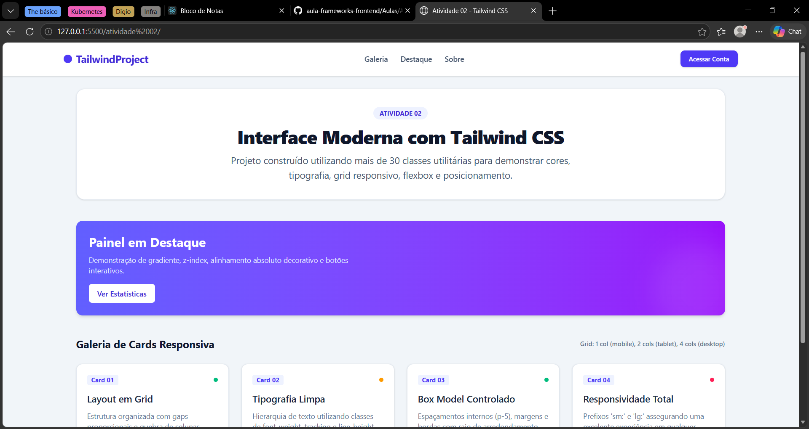
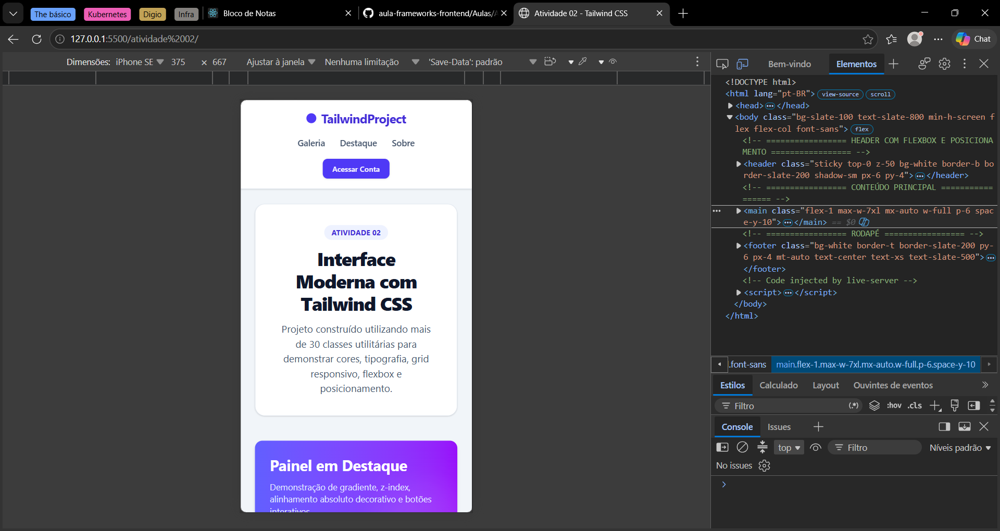
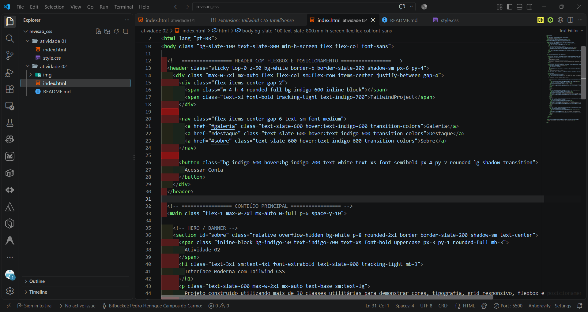

# Atividade 02 - Desenvolvimento com Tailwind CSS

Este projeto consiste na criação de uma interface moderna, responsiva e visualmente organizada utilizando o framework **Tailwind CSS**. A página foi desenvolvida para demonstrar o uso de classes utilitárias em componentes de navegação, banner principal, cards responsivos e painel em destaque.

---

## 🔗 Links do Projeto
- **Repositório do projeto:** https://github.com/w-tangly/senai-framework-web
- **Execução local:** abrir o arquivo `aula_07/atividade 02/index.html` em um navegador, ou usar uma extensão como Live Server no VS Code.
- **Deploy/visualização online:** não foi publicado em plataforma externa; a demonstração foi validada em ambiente local.

---

## 📌 Objetivo da Atividade
O objetivo da atividade foi aplicar os conceitos da aula de frameworks CSS, especialmente o uso do Tailwind CSS para construir interfaces com:
- responsividade para desktop, tablet e mobile;
- sistema de grid e flexbox;
- espaçamento e bordas controlados;
- tipografia e contraste adequados;
- cores, gradientes e hover states;
- componentes estruturados com classes utilitárias.

---

## 📸 Demonstração do Projeto

### 1. Layout em desktop

*Figura 1: Visão geral da interface em tela desktop.*

### 2. Layout responsivo em mobile

*Figura 2: Ajuste do layout para dispositivos móveis.*

### 3. Trecho do código-fonte no VS Code

*Figura 3: Estrutura HTML com classes utilitárias do Tailwind CSS.*

---

## 🧩 Estrutura do Projeto
A atividade foi organizada em arquivos simples e objetivos:

- `index.html` — estrutura da interface com elementos HTML e classes Tailwind.
- `img/` — imagens de demonstração do projeto.
- `README.md` — documentação do projeto.

---

## 📋 Classes Tailwind CSS Utilizadas
Foram aplicadas mais de 30 classes utilitárias para cobrir as principais categorias do CSS e demonstrar as possibilidades do framework.

| Categoria | Classe | Função / Propriedade CSS equivalente |
|---|---|---|
| Cores | `bg-slate-100` | Fundo cinza claro do corpo da página |
| Cores | `bg-white` | Fundo branco em blocos e cards |
| Cores | `bg-indigo-600` | Cor principal de destaque e botão |
| Cores | `bg-indigo-50` | Fundo suave para labels e destaques |
| Cores | `text-slate-800` | Texto escuro principal |
| Cores | `text-slate-600` | Texto secundário e navegação |
| Cores | `text-white` | Texto em elementos interativos |
| Cores | `hover:bg-indigo-700` | Mudança de cor ao passar o mouse |
| Tipografia | `text-xs` | Texto pequeno |
| Tipografia | `text-sm` | Texto de apoio |
| Tipografia | `text-lg` | Tamanho de texto médio |
| Tipografia | `text-xl` | Tamanho de título médio |
| Tipografia | `text-2xl` | Título de seção |
| Tipografia | `text-3xl` | Cabeçalho principal |
| Tipografia | `text-4xl` | Título destacado |
| Tipografia | `font-bold` | Texto em negrito |
| Tipografia | `font-semibold` | Texto semibold |
| Tipografia | `font-extrabold` | Título com peso máximo |
| Tipografia | `tracking-tight` | Ajuste fino do espaçamento entre letras |
| Tipografia | `text-center` | Alinhamento central do texto |
| Espaçamento | `p-6` | Padding geral |
| Espaçamento | `px-4` | Padding horizontal |
| Espaçamento | `py-2` | Padding vertical |
| Espaçamento | `mb-3` | Margem inferior |
| Espaçamento | `mx-auto` | Centralização horizontal |
| Espaçamento | `space-y-10` | Espaço vertical entre elementos |
| Dimensões | `w-full` | Largura total |
| Dimensões | `min-h-screen` | Altura mínima de 100vh |
| Dimensões | `max-w-7xl` | Limite máximo de largura do container |
| Bordas | `border` | Borda padrão |
| Bordas | `border-slate-200` | Borda com cinza claro |
| Bordas | `rounded-lg` | Cantos arredondados |
| Bordas | `rounded-xl` | Cantos mais suaves em cards |
| Bordas | `rounded-full` | Elementos circulares ou com borda completa |
| Posicionamento | `relative` | Posicionamento relativo |
| Posicionamento | `absolute` | Posicionamento absoluto |
| Posicionamento | `sticky` | Elemento fixo durante a rolagem |
| Posicionamento | `top-0` | Alinhamento no topo |
| Posicionamento | `z-50` | Sobreposição de camadas |
| Flexbox | `flex` | Container em flexbox |
| Flexbox | `flex-col` | Direção em coluna |
| Flexbox | `items-center` | Alinhamento vertical central |
| Flexbox | `justify-between` | Distribuição de espaço entre itens |
| Flexbox | `gap-4` | Espaçamento entre elementos flex |
| Flexbox | `gap-6` | Espaçamento mais amplo entre cards |
| Grid | `grid` | Habilita layout em grid |
| Grid | `grid-cols-1` | 1 coluna em mobile |
| Grid | `sm:grid-cols-2` | 2 colunas em telas médias |
| Grid | `lg:grid-cols-4` | 4 colunas em telas grandes |
| Responsividade | `sm:flex-row` | Layout em linha em telas maiores |
| Responsividade | `hover:-translate-y-1` | Efeito de elevação ao passar o mouse |
| Responsividade | `transition` | Suavização de transições |
| Responsividade | `duration-200` | Tempo de transição |

---

## ⚙️ Como Executar o Projeto

### Opção 1 — abrir diretamente no navegador
1. Acesse a pasta `aula_07/atividade 02`.
2. Abra o arquivo `index.html` no navegador.
3. A página será renderizada com o Tailwind via CDN automaticamente.

### Opção 2 — VS Code com Live Server
1. Abra a pasta do projeto no VS Code.
2. Instale a extensão **Live Server**.
3. Clique com o botão direito em `index.html` e selecione **Open with Live Server**.
4. O projeto será aberto em uma aba do navegador local.

### Opção 3 — servidor local simples via terminal
```bash
cd "C:\Users\Pedro Campos\Documents\GitHub\senai-framework-web\aula_07\atividade 02"
python -m http.server 8000
```
Depois acesse:
```bash
http://localhost:8000
```

---

## ✅ Conclusão
A atividade foi concluída com sucesso, demonstrando a aplicação prática dos conceitos de Tailwind CSS em uma interface moderna e responsiva. O projeto utilizou classes utilitárias para estruturar o layout, definir espaçamento, cores, tipografia, gradientes, grid e flexbox, além de garantir adaptação visual em diferentes tamanhos de tela.

Essa abordagem reforça a importância dos frameworks CSS na produtividade do desenvolvimento front-end, permitindo criar interfaces consistentes, organizadas e reutilizáveis com menos código manual.
